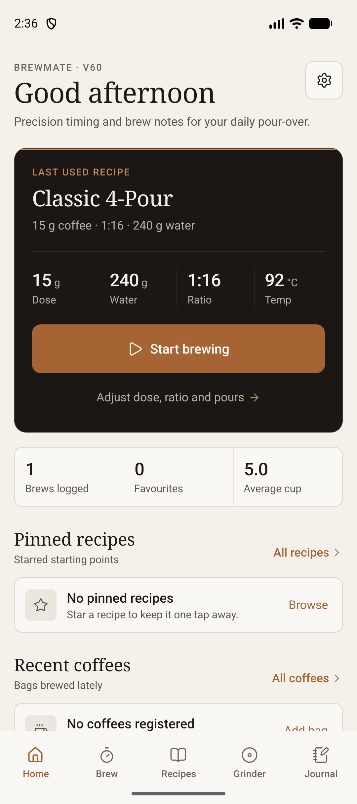
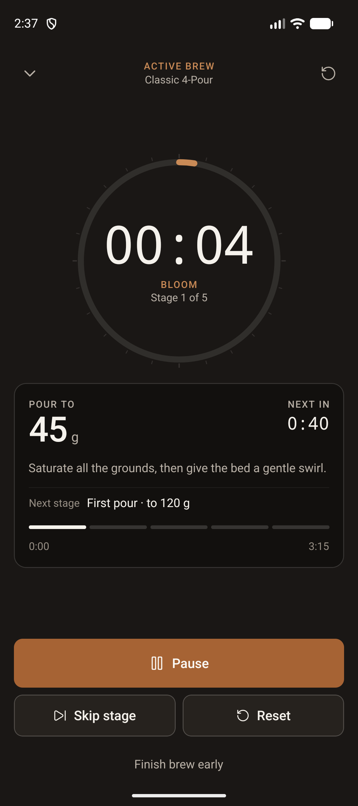
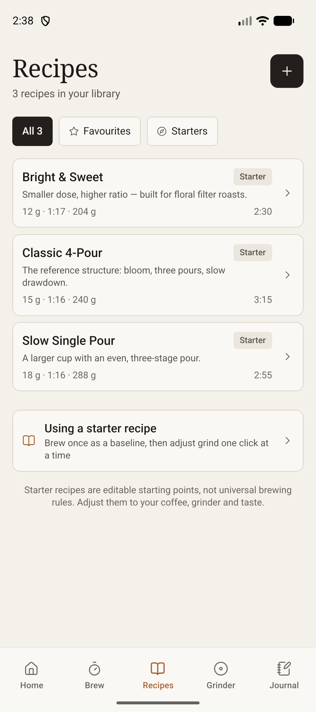
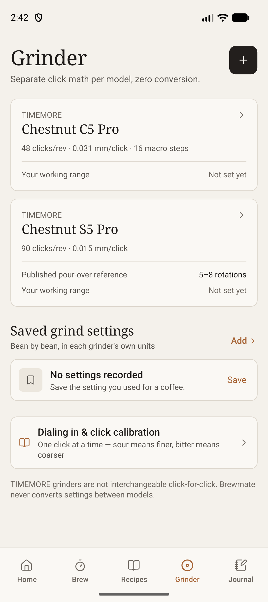
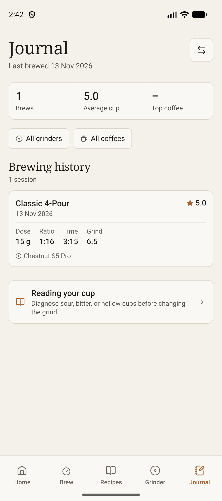
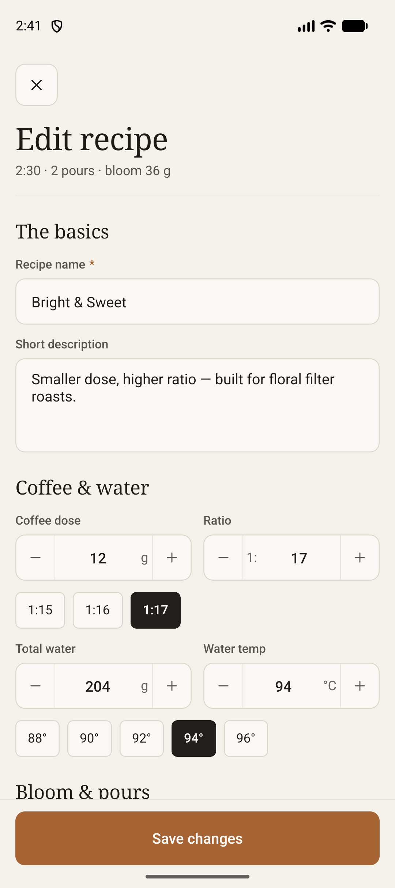
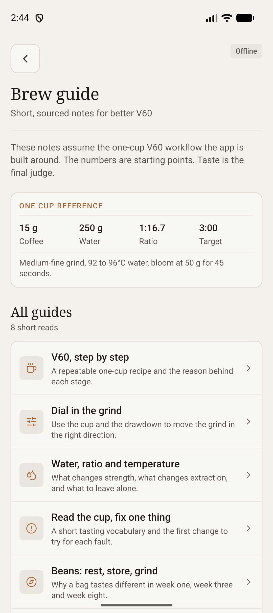
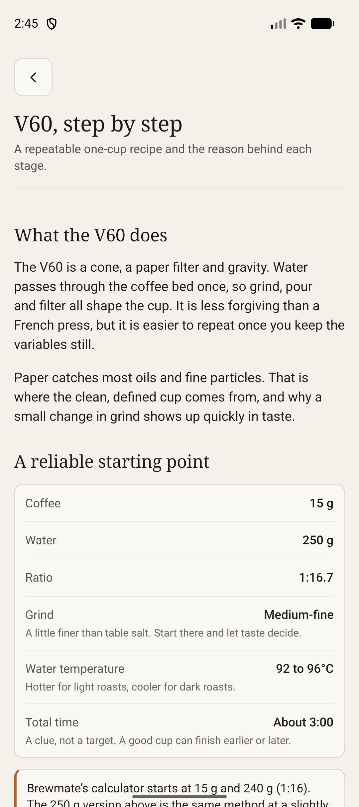
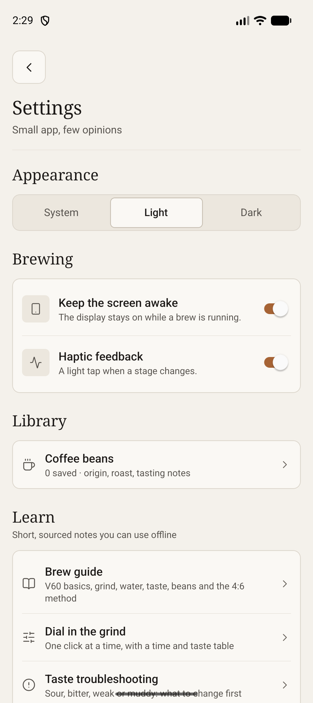

# Brewmate — V60 Coffee Companion

An offline-first Android app for Hario V60 pour-over brewing, built around the
TIMEMORE Chestnut **S5 Pro** and **C5 Pro** hand grinders.

Brewmate calculates your water, times your pours, keeps a grind log per coffee
and remembers how the cup actually tasted. It also carries an offline brew guide
with the reasoning behind the numbers. Everything lives in a local SQLite
database — no account, no network, no tracking.

**Current release:** [v1.2.0](https://github.com/agungkrishna-code/brewmate/releases/tag/v1.2.0)
· [Download the APK](https://github.com/agungkrishna-code/brewmate/releases/download/v1.2.0/Brewmate-1.2.0.apk)

---

## What it does

**Home** — a greeting, your last-used recipe, one-tap start, a hairline metric
strip (brews, favourites, average cup), pinned recipes, recent coffees and a link
to the brew guide.

**Brew (calculator)** — dose, ratio, total water, temperature, bloom multiplier
and any number of pour stages. Fields use docked −/+ steppers, the live plan
reads back dose, water, ratio and time, and every stage is editable. The water
always adds up: the final stage lands exactly on the total, to 0.1 g.

**Brewing timer** — a full-screen charcoal instrument with a ticked progress
ring, the current stage, the cumulative scale target, the instruction for that
stage and a preview of the next pour. Pause, resume, skip a stage, reset. Elapsed
time is derived from wall-clock timestamps, so backgrounding the app or a slow JS
thread never drifts the timer. The screen stays awake while brewing and a light
haptic fires on each stage change. At the end you can log the brew with ratings
and notes.

**Recipes** — create, edit, duplicate, delete, favourite. Each recipe stores
dose, ratio, temperature, grinder, grind setting, bloom, the full pour schedule,
target time and notes. Three clearly-labelled **starter recipes** ship with the
app; they are editable starting points, not brewing rules.

**Grinder** — two built-in profiles plus custom grinders. Saves the setting you
used for a specific coffee, linked to a recipe, with the latest tasting score.
Never converts a setting between models.

**Coffee beans** — name, origin, country, region, farm, variety, processing
method, roast level, roast date, tasting notes and personal notes. Archive a bag
without losing its history.

**Journal** — every session with dose, ratio, temperature, stages, total time,
grinder and grind setting, plus six 1–5 ratings (acidity, sweetness, bitterness,
body, clarity, aftertaste). Filter by grinder or coffee, compare two brews side
by side, and see your aggregate stats.

**Brew guide** — eight offline articles on V60 basics, grind dial-in, water and
ratio, taste troubleshooting, bean freshness, pour technique, TIMEMORE
calibration and the 4:6 method, available in both **English** and **Indonesian**.
Each article is written for the one-cup workflow the app supports and lists its
own sources.

**Settings** — System / Light / Dark appearance, System / English / Indonesia
language selector (follows the device locale when set to System), haptics,
keep-awake, a compact library strip (coffees, recipes, brews), JSON export and
restore, plus a **Learn** section that opens the guide and two troubleshooting
articles.

## Screens

<table>
  <tr>
    <td></td>
    <td></td>
    <td></td>
  </tr>
  <tr>
    <td align="center"><sub>Home</sub></td>
    <td align="center"><sub>Brewing timer</sub></td>
    <td align="center"><sub>Recipes</sub></td>
  </tr>
  <tr>
    <td></td>
    <td></td>
    <td></td>
  </tr>
  <tr>
    <td align="center"><sub>Grinder</sub></td>
    <td align="center"><sub>Journal</sub></td>
    <td align="center"><sub>Recipe editor</sub></td>
  </tr>
  <tr>
    <td></td>
    <td></td>
    <td></td>
  </tr>
  <tr>
    <td align="center"><sub>Brew guide</sub></td>
    <td align="center"><sub>V60 article</sub></td>
    <td align="center"><sub>Settings</sub></td>
  </tr>
</table>

Captured from the current development build on a Pixel 9 API 37 emulator, in
light mode. The timer keeps its charcoal instrument surface in both themes.

---

## Grinder data used

| | TIMEMORE Chestnut S5 Pro | TIMEMORE Chestnut C5 Pro |
|---|---|---|
| Clicks per rotation | 90 | 48 |
| Macro steps per rotation | — | 16 |
| Adjustment per click | 0.015 mm (15 µm) | 0.031 mm (31 µm) |
| Manufacturer pour-over reference | 5.0–8.0 on the dial | not published |
| How Brewmate reads a setting | dial rotations (`6.5` → 585 clicks) | clicks from zero (`20` → 0 rot 20 clicks) |

> One click on an S5 Pro is **not** one click on a C5 Pro. Brewmate deliberately
> refuses to convert between the two; it only converts within one model (rotations
> ↔ clicks ↔ burr travel) and shows the arithmetic so you can sanity-check it.

The manufacturer reference is shown as a fact. Your own working range, stored as
"your calibration", is what the app uses for the in-range indicator.

---

## Stack

- Expo SDK 58, React Native 0.88, React 19.3, TypeScript (strict)
- Expo Router (file-based routing, JavaScript tabs)
- `expo-sqlite` with `PRAGMA user_version` migrations
- React Context + hooks for state (no Redux, no external state library)
- `react-native-svg` for the timer ring
- `expo-haptics`, `expo-keep-awake`, `expo-file-system`, `expo-sharing`,
  `expo-document-picker`
- React Native `StyleSheet` only — no UI framework, no downloaded fonts
- `lucide-react-native` for icons, wrapped once in `AppIcon` with a uniform
  1.65 stroke — one icon set across the whole app

---

## Project structure

```
src/
  app/                       routes (Expo Router)
    (tabs)/index.tsx         Home
    (tabs)/brew.tsx          calculator
    (tabs)/recipes.tsx       recipe library
    (tabs)/grinder.tsx       grinder hub
    (tabs)/journal.tsx       brewing history
    brewing/timer.tsx        full-screen brew timer
    recipes/[id].tsx         recipe detail
    recipes/new.tsx          new recipe (accepts a calculator prefill)
    recipes/edit.tsx         edit recipe
    beans/                   coffee list, create, edit
    guide/index.tsx          brew guide index
    guide/[slug].tsx         guide article
    grinders/[id].tsx        grinder detail + calibration
    grinders/new.tsx         custom grinder
    journal/[id].tsx         session detail + tasting review
    journal/compare.tsx      two-brew comparison
    settings/index.tsx       theme, language, haptics, backup, about
  components/
    common/                  text, icon, screen, button, field, sheet, section,
                             stat, empty-state, rating, brand-card
    brewing/                 plan inputs, stage editor, stage list, timer ring
    recipes/  grinder/  journal/  beans/
  constants/                 theme tokens, defaults, starter recipes, guide content (en + id)
  contexts/                  settings (preferences) and the in-memory brew draft
  database/                  schema, migrations, seeds, bootstrap
  hooks/                     use-brew-plan, use-brewing-timer, use-database,
                             use-language, use-theme
  i18n/                      typed English and Indonesian dictionaries + locale detection
  services/                  calculator, timeline, grinders, beans, recipes,
                             journal, preferences, backup
  types/                     grinder, coffee, recipe, brewing
  utils/                     calculations, grinder maths, formatting, validation
tests/logic.test.ts          water maths, timeline, grinder clicks, validation,
                             guide integrity, i18n parity
```

---

## Data model

```
grinder_profiles ──┬── brew_recipes ── brew_pour_steps
                   │         │
                   │         └── brew_sessions ── brew_session_steps
                   │                    │
                   │                    └── brew_session_ratings
                   ├── grind_settings ── coffee_beans
                   └── (brew_sessions)
coffee_beans ──────┘
user_preferences (key/value)
```

- Text UUID-style ids generated locally (`utils/id.ts`).
- Foreign keys are enabled per connection; deletes cascade where it makes sense
  (`steps`, `ratings`) and `SET NULL` where history must survive (a session keeps
  name snapshots of its bean, recipe and grinder).
- Indexes on session date, bean, grinder, pour steps and grind settings.
- Migrations run in a transaction and bump `PRAGMA user_version`.
- Seeding is idempotent: the two TIMEMORE profiles are re-checked on every
  launch, starter recipes only on first creation.

---

## Water arithmetic (the invariant)

1. `totalWater = round1(dose × ratio)`
2. `bloomWater = round1(dose × bloomMultiplier)`
3. `remaining = totalWater − bloomWater`
4. Remaining water is split across pours; the last stage absorbs rounding.
5. Editing one stage moves the difference into a neighbouring stage, keeping the
   total exact and every stage ≥ 0.1 g.

Stored steps use **cumulative** scale targets, so the timer can read a single
number. `tests/logic.test.ts` asserts the totals, the round-trip between
per-stage amounts and cumulative targets, and that cumulative targets never
decrease.

---

## Menjalankan project (panduan Bahasa Indonesia)

Panduan ini ditulis untuk Windows + Android Studio, karena target app ini hanya
Android. Bagian bahasa Inggris di bawah tetap berlaku sebagai referensi.

### 1. Prasyarat

| Kebutuhan | Versi | Cek dengan |
|---|---|---|
| Node.js | LTS (20 atau 22) | `node -v` |
| npm | ikut Node | `npm -v` |
| JDK | 17 atau lebih baru (diuji dengan JDK 25) | `java -version` |
| Android Studio | versi stabil terbaru | — |
| Android SDK Platform | 37 (compileSdk project) | SDK Manager |
| Emulator (AVD) | contoh `Pixel_9_API_37` | Device Manager |

`ANDROID_HOME` harus menunjuk ke folder SDK. Kalau belum ada:

```powershell
setx ANDROID_HOME "$env:LOCALAPPDATA\Android\Sdk"
setx ANDROID_SDK_ROOT "$env:LOCALAPPDATA\Android\Sdk"
```

Tutup dan buka lagi terminal setelah `setx`. Pastikan `JAVA_HOME` juga menunjuk
ke JDK 17 atau lebih baru: proyek ini memakai Gradle 9.4.1 + AGP 9, dan build
Android sudah diverifikasi berjalan di JDK 25.

### 2. Install dependency

```powershell
npm install
```

### 3. Siapkan emulator dari Android Studio

1. Buka Android Studio → **Tools → Device Manager**.
2. Klik ▶ pada AVD yang ada (misalnya `Pixel_9_API_37`). Kalau belum punya,
   **Create Virtual Device** → pilih Pixel 9 → system image **API 37
   (x86_64)**.
3. Tunggu sampai layar home Android muncul (bukan logo booting).
4. Verifikasi dari terminal:

```powershell
adb devices
```

Status harus `device`, **bukan** `offline` atau kosong.

> Kalau emulator stuck di `offline` (pernah terjadi di mesin ini), matikan lalu
> jalankan cold boot:
>
> ```powershell
> adb kill-server
> & "$env:LOCALAPPDATA\Android\Sdk\emulator\emulator.exe" -avd Pixel_9_API_37 -no-snapshot-load -no-boot-anim
> ```

### 4. Jalankan app

**Cara A — development (hot reload, dipakai sehari-hari).**

```powershell
npx expo start
```

Metro jalan di `http://localhost:8081` dan **fast refresh aktif**: simpan file,
layar emulator langsung berubah tanpa restart.

Di terminal lain, sambungkan port Metro ke emulator lalu buka app:

```powershell
adb reverse tcp:8081 tcp:8081
adb shell am start -n com.brewmate.v60/.MainActivity
```

Pertama kali, app harus dipasang dulu (boleh pakai APK debug yang sudah ada):

```powershell
adb install -r android\app\build\outputs\apk\debug\app-debug.apk
```

**Cara B — sekali perintah (build + install + Metro).**

```powershell
npx expo run:android
```

Perintah ini mengompilasi ulang bagian native lewat Gradle, jadi butuh waktu
lebih lama. Lihat catatan penting di poin 6 kalau build native gagal.

### 5. Perintah pemeriksaan

```powershell
npm run typecheck      # TypeScript strict, tanpa emit
npm test               # perhitungan air, timeline, klik grinder, validasi, guide
npm run lint           # ESLint
python scripts\verify-schema.py      # skema + semua query service di SQLite asli
```

### 6. Penting: path folder non-ASCII

Checkout ini berada di `C:\Users\dewag\OneDrive\Desktop\brewmate`, jadi path-nya
ASCII dan build native langsung berjalan. Kalau project dipindah ke folder
dengan karakter non-ASCII (misalnya nama lama
`Brewmate – V60 Coffee Companion` dengan **en dash**), ada dua masalah sekaligus:

1. Plugin Gradle-nya menolak melakukan konfigurasi pada path non-ASCII. Project
   ini sudah menyiasatinya lewat `plugins/with-gradle-path-override.js`
   (`android.overridePathCheck=true`).
2. **Clang di NDK tetap gagal** membuka path tersebut, sehingga kompilasi C++
   (misalnya `react-native-worklets`) berhenti dengan:

   ```
   fatal error: cannot open file
   'C:/Users/.../Brewmate <96> V60 Coffee Companion/.../WorkletsPCH.h'
   ```

Selama path-nya masih non-ASCII, `npx expo run:android` **akan gagal**.
Ada dua jalan keluar:

- **Praktis:** jalankan `scripts/build-android.ps1` (lihat bawah). Script ini
  menyalin project ke `%TEMP%\brewmate-native-build` yang path-nya ASCII murni,
  build di sana, lalu mengembalikan APK-nya ke folder ini.
- **Permanen:** pindahkan project ke path ASCII saja, contoh `C:\dev\brewmate`.
  Setelah itu semua perintah Expo/`run:android` berjalan normal.

### 7. Build APK

Release (bisa dipasang mandiri, JS bundle ikut di dalamnya — ini yang dipakai
untuk berbagi file APK):

```powershell
powershell -ExecutionPolicy Bypass -File scripts\build-android.ps1 -Variant release
```

Debug (butuh Metro yang jalan di komputer, hanya untuk development):

```powershell
powershell -ExecutionPolicy Bypass -File scripts\build-android.ps1
```

Hasilnya:

```
android\app\build\outputs\apk\release\app-release.apk
android\app\build\outputs\apk\debug\app-debug.apk
```

Pasang ke emulator atau HP:

```powershell
adb install -r android\app\build\outputs\apk\release\app-release.apk
```

APK release ditandatangani dengan `debug.keystore` yang di-generate otomatis.
Aman untuk dipasang sendiri (sideload), tapi buat keystore sendiri sebelum
mengunggah ke Play Store.

### 8. Masalah yang sering muncul

| Gejala | Penyebab | Solusi |
|---|---|---|
| `adb devices` kosong | emulator belum selesai boot | tunggu, atau cold boot (poin 3) |
| Emulator `offline` terus | snapshot rusak | `-no-snapshot-load`, atau **Wipe Data** di Device Manager |
| Layar app stuck di splash | app tidak bisa menghubungi Metro | jalankan `adb reverse tcp:8081 tcp:8081`, pastikan Metro hidup |
| `Unable to load script` | APK debug dibuka tanpa Metro | jalankan `npx expo start` atau pakai APK release |
| Build gagal di `WorkletsPCH.h` | path non-ASCII | pakai `scripts\build-android.ps1` (poin 6) |
| `ninja: error: manifest ... too long` | ninja bawaan CMake 3.22.1 | sudah ditangani otomatis oleh script build |
| Metro 500, `unable to resolve module` | cache Metro dibuat sebelum dependency baru di-install | hentikan Metro, lalu `npx expo start --clear` |
| `INSTALL_FAILED_VERSION_DOWNGRADE` | `versionCode` APK lokal lebih rendah dari app terpasang | jalankan `npx expo prebuild --platform android`, atau uninstall app lama |
| Perubahan kode tidak muncul | Metro dalam mode CI | jalankan `npx expo start` tanpa `CI=1` |

### 9. Data hilang saat uninstall

Database SQLite disimpan di dalam sandbox app. **Uninstall = database terhapus.**
Kalau riwayat brew penting, buka **Settings → Export** dulu dan simpan file
JSON-nya.

---

## Getting started

Requirements: Node.js LTS, npm, and (for the Android build) JDK 17+ with the
Android SDK.

```bash
npm install
npx expo start          # Metro; press "a" with a device/emulator attached
```

Checks:

```bash
npm run typecheck       # tsc --noEmit
npm test                # calculator, timeline, grinder, validation and guide checks
npm run lint            # eslint
python scripts/verify-schema.py     # schema + every service query against real SQLite
npx expo export --platform android  # proves the production bundle compiles
```

---

## Building the APK locally

Build script (handles prebuild and the path check for you):

```powershell
powershell -ExecutionPolicy Bypass -File scripts/build-android.ps1
powershell -ExecutionPolicy Bypass -File scripts/build-android.ps1 -Variant release
```

Or by hand:

```bash
npx expo prebuild --platform android
npx expo run:android            # builds and installs on a connected device
```

Standalone APKs:

```powershell
cd android
.\gradlew.bat assembleDebug      # android/app/build/outputs/apk/debug/app-debug.apk
.\gradlew.bat assembleRelease    # android/app/build/outputs/apk/release/app-release.apk
```

- **debug** is a development build: it expects Metro on your machine
  (`npx expo start`), so it is not useful as a standalone install.
- **release** embeds the JavaScript bundle and is signed with the generated
  `debug.keystore`, so it installs and runs on its own. It is fine for personal
  sideloading; generate your own keystore before publishing anywhere.

### Windows build notes

Two Windows-specific issues are handled by `scripts/build-android.ps1`:

1. **Non-ASCII path.** If the project sits in a folder whose name contains
   non-ASCII characters (the old checkout used an en dash), Expo's Android plugin
   refuses to configure it. `plugins/with-gradle-path-override.js` writes
   `android.overridePathCheck=true` into `android/gradle.properties` on every
   `expo prebuild`, which satisfies the AGP check. That is not enough on its own:
   clang under the NDK still cannot open such paths, so the script mirrors the
   project to `%TEMP%\brewmate-native-build` and builds there. The current
   checkout lives in an ASCII path (`...\Desktop\brewmate`) and builds directly.

2. **Old ninja.** The ninja bundled with the SDK's CMake 3.22.1 hard-fails when an
   object path exceeds 260 characters, and React Native's generated codegen paths
   are around 320. The script detects a ninja older than 1.11, downloads a current
   one, prepares a private copy of CMake and points `android/local.properties` at
   it (`cmake.dir`). Using an ASCII-only path removes the need for step 1 but not
   for step 2.

Notes:

- `android/` and `ios/` are generated by `expo prebuild` (Continuous Native
  Generation). Do not hand-edit them; change `app.json` instead.
- Set `ANDROID_HOME` (e.g. `%LOCALAPPDATA%\Android\Sdk`) and make sure
  `JAVA_HOME` points at a JDK that Gradle accepts (17 or newer; JDK 25 is what
  this checkout was built with).
- Release signing is not configured. For a Play Store build you need a keystore
  and a release `build.gradle`; debug builds are self-signed and fine for
  sideloading.
- The Android package id is `com.brewmate.v60`.

---

## Offline, privacy and data loss

- No network calls, no analytics, no accounts. The app works in airplane mode.
- The brew guide is bundled static content. Sources are named in each article;
  nothing is fetched at runtime.
- Backups are plain JSON written to the app cache and handed to Android's share
  sheet, so you choose where they go.
- Restoring merges by id (existing rows with the same id are replaced).
- **Uninstalling the app deletes the local database.** Export a backup first if
  the history matters.

---

## Design notes

- One system, two moods. Light is warm stone paper (`#F4F1EB` page, `#FAF8F4`
  surface); dark is matte charcoal (`#131110` page, `#1E1B18` surface). A single
  muted copper-amber accent (`#A66334` light, `#C98A56` dark) is reserved for
  primary actions and active states.
- The hero cards and the running timer sit on a fixed charcoal "instrument"
  surface (`#1A1715`, deep `#12100E`) in both themes, so the app keeps one
  signature whether the room is bright or dark.
- Structure over decoration: hairline borders, 4–14 px radii, no gradients and
  no drop shadows. Spacing comes from one scale so screens share the same
  rhythm.
- Type: system serif for editorial headings, system sans for UI, and tabular
  numerals for every dose, ratio, time, temperature and metric so figures never
  jitter. No downloaded fonts, so first launch stays instant and offline.
- Icons: one library only, `lucide-react-native`, wrapped in `AppIcon` at a
  uniform 1.65 stroke. No mixed outline/filled sets and no emoji.
- Components: `AppText` variants (including `metricHero`, `metric`,
  `metricSmall` and `mono`), `Button`/`IconButton`, a docked-stepper
  `NumberField`, `MetricStrip`, compact `EmptyState` with `LoadingState` and
  `ErrorState`, and a keyboard-aware `BottomSheet`. Screens compose them; no
  screen owns SQL — all queries live in `services/`.
- Ergonomics and contrast: 44–48 dp touch targets, WCAG-AA faint-text tokens,
  and scroll content that measures the fixed footer so the primary action never
  covers the last row.

---

## Known limitations

- The timer is a foreground experience. If Android kills the app while it is in
  the background, the in-memory plan is lost (elapsed time itself is timestamp
  based, so returning from the background within the app's lifetime is correct).
- No notifications when a stage ends; the app relies on haptics and the visible
  screen (which is kept awake).
- Roast dates are typed as `yyyy-mm-dd` rather than picked from a calendar, to
  avoid an extra native dependency.
- The brew guide is static content. Corrections ship with an app update, and its
  sources are listed as text rather than clickable links.
- iOS is not configured or tested; the target is Android.

---

## Disclaimer

Starter recipes, the 5.0–8.0 S5 Pro reference and every default in this app are
starting points for tasting, not prescriptions. Grind finer or coarser, change
the temperature, and trust the cup.
